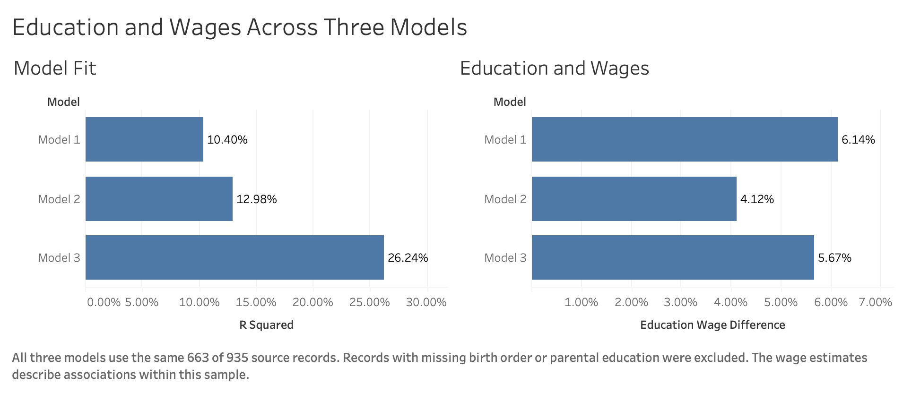

# Education and Wages Across Three Models

I used Excel to build three regression models and Tableau to show how the
relationship between education and wages changed as I added more variables.

## What I found

| Model | Predictors added | R² | Estimated wage difference per extra year of education |
|---|---|---:|---:|
| 1 | Education | 10.40% | 6.14% |
| 2 | IQ | 12.98% | 4.12% |
| 3 | Experience, tenure, marital status, race, region, and urban residence | 26.24% | 5.67% |

The estimate fell from 6.14% to 4.12% after adding IQ. It rose to 5.67%
after adding the remaining variables. These figures describe associations
within the sample.

## Data and method

All three models used the same 663 of 935 source records. Records with
missing birth order or parental education were excluded. The models used
the natural log of wages as the outcome. I converted each education
coefficient to a wage percentage using `EXP(coefficient) - 1`.
